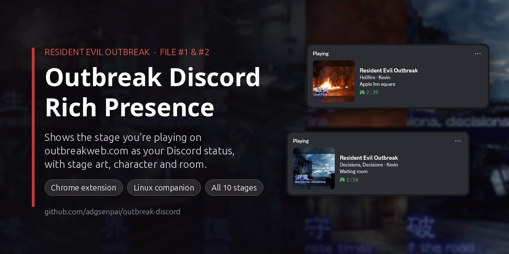
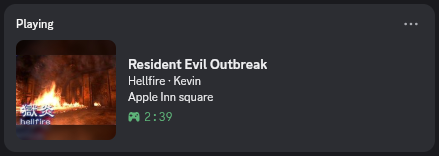
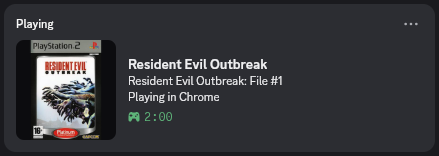
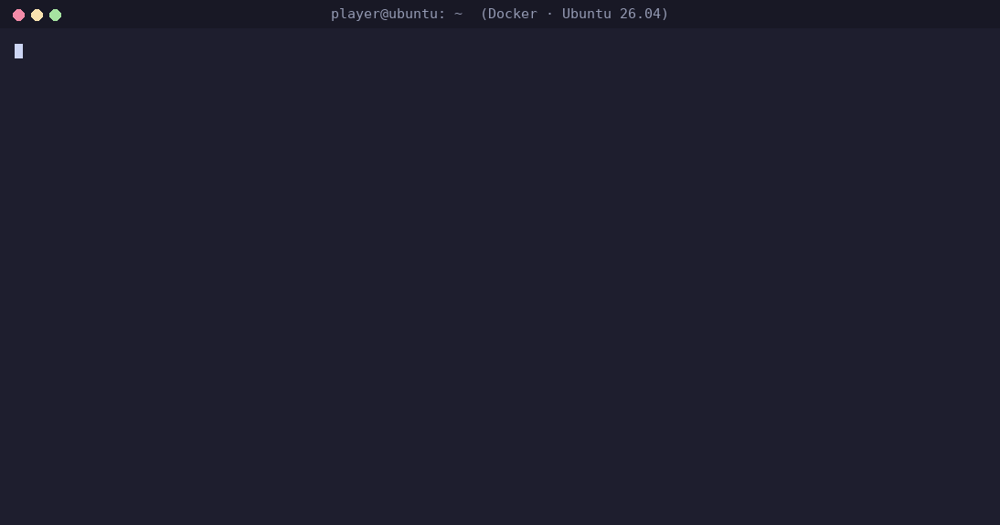

# Outbreak Discord Rich Presence



Discord Rich Presence for **Resident Evil Outbreak File #1 and File #2** played in the browser at [outbreakweb.com](https://outbreakweb.com). A Chrome extension reads which stage you're in, and a small local companion sends it to your Discord desktop app, with stage artwork, your character and current room.

<p>
  
  
</p>

When you're in the menus or between stages, it falls back to the game cover:



## Features

- **Automatic stage detection** for all ten scenarios, read from the game's own scenario ID (no guessing from room names).
- **Stage artwork** for every scenario, plus File #1 / File #2 covers.
- Shows **character** and **current room**, and a "Play Outbreak File #N" button.
- Keeps your status while the game tab is open, even when Chrome isn't the focused window.
- **One-click install** on Windows (self-installing `.exe`) and Linux (one-line installer), and it starts automatically at login.
- Talks only to `127.0.0.1`. The companion accepts requests only from the Chrome extension (or a pairing token).

## How it works

```
outbreakweb.com tab ──► Chrome extension ──► local companion (127.0.0.1:8766) ──► Discord desktop (IPC)
   page-bridge.js         content.js /           companion/server.py
   (reads scen + room)    background.js          + stages.py (scen → stage)
```

1. `extension/page-bridge.js` runs in the page and calls the site's own read-only tracker reader (`trkRead()`) every 2 seconds. It gets the **scenario ID** and your **room**. This works whether or not the site's tracker panel is visible.
2. `extension/content.js` adds the character name and room label from the tracker cards. `extension/background.js` posts everything to the companion about every 30 seconds.
3. `companion/server.py` maps the scenario ID to a stage and updates your Discord presence through pypresence. If nothing arrives for 75 seconds, it clears the presence.

### Scenario IDs

The game's scenario ID is the stage's data-archive number on the disc (`rNNN.afs`). The table comes from the [Resident Evil Wiki scenario table](https://residentevil.fandom.com/wiki/Network_Biohazard). The ✓ rows were confirmed in-game.

| File | ID | Stage | Discord asset key |
|---|---|---|---|
| #1 | 1 | Outbreak | `outbreak_hd` |
| #1 | 2 | Hellfire ✓ | `hellfire_hd` |
| #1 | 28 | The Hive ✓ | `the_hive_hd` |
| #1 | 35 | Below Freezing Point | `below_freezing_point_hd` |
| #1 | 41 | Decisions, Decisions ✓ | `decisions_decisions_hd` |
| #2 | 10 | Underbelly | `underbelly_hd` |
| #2 | 15 | Desperate Times | `desperate_times_hd` |
| #2 | 26 | Flashback | `flashback_hd` |
| #2 | 40 | Wild Things ✓ | `wild_things_hd` |
| #2 | 6 | End of the Road ✓ | `end_of_the_road_hd` |
| #1 | not detected | File #1 cover | `outbreak_file1` |
| #2 | not detected | File #2 cover | `outbreak_file2` |

End of the Road (6) isn't in the wiki table; it was confirmed in-game. As a safety net, any other File #2 ID is also treated as End of the Road, since File #2 has only five scenarios. If a stage ever shows the wrong art, look for `scen=N` in the companion log and fix `SCENARIO_IDS` in `companion/stages.py`.

## Install

**[⬇ Download the latest release](https://github.com/adgsenpai/outbreak-discord/releases/latest)**

> 🪟 **New to this? Follow the [step-by-step Windows guide](docs/WINDOWS.md)**. It covers which files to download, the SmartScreen warning, loading the extension, and fixes for common problems.

### 1. Companion app (one click)

| | |
|---|---|
| **Windows** | Download **`OutbreakDiscordCompanion.exe`** and double-click it. It installs itself, runs in the background, and starts with Windows. If SmartScreen warns (the app isn't code-signed), click **More info → Run anyway**. |
| **Linux** (x86_64) | `curl -fsSL https://raw.githubusercontent.com/adgsenpai/outbreak-discord/main/scripts/install.sh \| bash` installs it as a systemd user service that starts at login. |

There's no Discord app to create and no token to paste: the companion uses the public "Resident Evil Outbreak" Discord app, which already has all the artwork.

**Linux install demo**: recorded for real in a fresh Ubuntu 26.04 Docker container, with nothing preinstalled except `curl`:



Uninstall:
- Windows: `%LOCALAPPDATA%\OutbreakDiscord\OutbreakDiscordCompanion.exe --uninstall`
- Linux: `~/.local/bin/outbreak-discord-companion --uninstall`

### 2. Chrome extension

Download **`outbreak-discord-extension-v*.zip`** from the release and unzip it. Open `chrome://extensions`, turn on **Developer mode**, click **Load unpacked**, and pick the unzipped folder. (A Chrome Web Store listing is being prepared.)

### 3. Play

Open <https://outbreakweb.com/file1/> or <https://outbreakweb.com/file2/> with the Discord **desktop** app running. Discord in a browser tab can't show game activity; you need the installed app from [discord.com/download](https://discord.com/download).

## Run from source

```bash
cd companion
python3 -m venv .venv
.venv/bin/pip install -r requirements.txt
.venv/bin/python server.py            # run in the foreground
.venv/bin/python server.py --install  # or: install as a systemd user service
```

Load the `extension/` folder unpacked as above. Logs go to `journalctl --user -u outbreak-discord -f` when it runs as a service.

**Using your own Discord app (optional).** Create an application at <https://discord.com/developers/applications>. Under **Rich Presence → Art Assets**, upload every file in `assets/discord_upload_hd/` and the two covers from `assets/discord_upload/`, a few at a time. Then start the companion with `--app-id YOUR_APPLICATION_ID`. The app's name is the title Discord shows.

**Releases.** Pushing a `v*` tag runs `.github/workflows/release.yml`. It builds the Windows `.exe` and Linux binary with PyInstaller, zips the extension and publishes a GitHub Release.

## Stage artwork

The ten stage images are cropped from a fan-made grid of the in-game scenario title cards.

- `crop_stage_grid.py` splits that 3/3/3/1 grid into `assets/real_stage_images/<stage>.png`.
- `import_real_stage_art.py` turns any screenshots in `assets/real_stage_images/` into 1024×1024 Discord art. Each image is scaled up to the full width and the empty space is filled with a blurred backdrop.

```bash
companion/.venv/bin/python crop_stage_grid.py assets/real_stage_images/stage_grid.jpeg
companion/.venv/bin/python import_real_stage_art.py
```

To use your own screenshots, save them as `assets/real_stage_images/<stage>.png` (or `.jpg`/`.webp`), using the stage keys from the table above without `_hd`. Then run the importer.

## Troubleshooting

- **No activity in Discord.** Check that Discord desktop is running, that **Settings → Activity Privacy → Share your activity** is on, and the companion log. Snap/Flatpak Discord is supported (the IPC socket under `$XDG_RUNTIME_DIR/snap.discord/` is found automatically).
- **Popup shows 🔴 Companion not running.** Install or start the companion. On Linux, check `systemctl --user status outbreak-discord`. On Windows, run the `.exe` again; it reinstalls and starts.
- **Port 8766 is in use.** Change `PORT` in `companion/server.py` and the two `127.0.0.1:8766` URLs in `extension/background.js` and `extension/manifest.json`, then reload the extension.
- **Cover instead of stage art.** You're in a menu or lobby, or the scenario ID is unmapped. Check `scen=` in the log.
- **Art not updating after re-uploading.** Discord caches assets by key, so upload changed art under a new key rather than replacing an existing one.
- **After changing extension files.** Reload the extension at `chrome://extensions`, then reload the game tab.

## Privacy

The full policy is in [PRIVACY.md](PRIVACY.md).

- The extension only runs on `outbreakweb.com/file1` and `/file2`. It reads the scenario ID, room number, character name and room label through the site's own tracker, and sends them only to the companion on `127.0.0.1`.
- Showing your online lobby room name is opt-in in the popup and off by default.
- Only what appears in your Discord status leaves your machine.

## Credits

Resident Evil Outbreak and all game artwork © CAPCOM. This is an unofficial fan project; it isn't affiliated with Capcom, Discord or outbreakweb.com. Scenario IDs come from the [Resident Evil Wiki](https://residentevil.fandom.com/wiki/Network_Biohazard) (CC-BY-SA).
